# Roadmap

Delivery order for the capabilities in `docs/tickets/capabilities.md`. Tickets do not exist yet. T3 cuts tickets from these capabilities. A ticket inherits its capability's phase, priority, and `blocked_by`. It may depend only on tickets in the same phase or an earlier one.

Checked: 33 capabilities, 0 cycles, 0 dependencies on a later phase.

## Existing five phases

`Docs/Plan/01-setup.md` through `Docs/Plan/05-phase-05-accounts-cloud-sync-credits.md` are the five phases that built the app that is running now:

1. Setup, shells, subjects, settings
2. Ingest, search, AI providers
3. Questions and study sessions
4. FSRS, points, streaks, tests, dashboard
5. Accounts, sync, credits

That work is already in the crates. The gaps are missing fields and behaviors on top of it. Putting this backlog back into those five phases would schedule new library, review, and analytics work inside phases that have already shipped. The five phases below are the delivery plan for the backlog.

## Priority

| Priority | Rule | Count |
|---|---|---|
| P0 | The designed core loop cannot proceed without it: a shared contract, a flag so the change can ship dark, a generation path when no model is configured, the review rating, or the quiz session | 5 |
| P1 | A main screen stays on placeholder data without it | 17 |
| P2 | An existing flow gains a control, a file, or a richer result | 10 |
| P3 | A single line of copy | 1 |

Priority does not override the build order. A P0 can sit in a later phase when a higher-screen capability is already unblocked and this one does not block it.

## Build order

Foundations first. After that, a capability is eligible when every `blocked_by` entry is already ordered. Ties go to the capability that unlocks more screens, then to the one earlier in the core loop: ingest, questions, quiz/review, score, dashboard.

`C03` blocks every product capability (C07–C32) because each ticket ships behind a flag. `C00` blocks new list endpoints and paid or AI calls that need the shared pagination and idempotency rules.

| # | Id | Capability | Priority | Phase | Blocked by | Screens |
|---:|---|---|---|---:|---|---:|
| 1 | C00 | API conventions | P0 | 1 | — | 0 |
| 2 | C03 | Feature flags | P0 | 1 | — | 0 |
| 3 | C01 | OpenAPI and client types | P1 | 1 | C00 | 0 |
| 4 | C02 | Job runner and job status | P1 | 1 | C00 | 0 |
| 5 | C04 | Audit log | P2 | 1 | C00 | 0 |
| 6 | C05 | Domain events and outbox | P1 | 1 | C00 | 0 |
| 7 | C06 | Seed data and test fixtures | P2 | 1 | — | 0 |
| 8 | C15 | Review load and next batch | P1 | 2 | C00, C03 | 4 |
| 9 | C16 | FSRS model | P2 | 2 | C02, C03 | 3 |
| 10 | C08 | Source metadata and import history | P1 | 2 | C00, C03 | 2 |
| 11 | C09 | URL import | P2 | 2 | C02, C03 | 2 |
| 12 | C10 | Ingest pipeline stages | P1 | 2 | C02, C03 | 2 |
| 13 | C11 | Subject taxonomy | P1 | 2 | C03 | 2 |
| 14 | C22 | Curriculum progress | P1 | 3 | C03, C11 | 5 |
| 15 | C19 | Exam plan and readiness | P1 | 3 | C03, C22 | 4 |
| 16 | C27 | Retention series | P1 | 3 | C03, C22 | 4 |
| 17 | C17 | Flashcard rating | P0 | 3 | C03 | 2 |
| 18 | C24 | Gold statistics | P2 | 3 | C03 | 2 |
| 19 | C23 | Knowledge score | P1 | 3 | C03, C22, C24 | 2 |
| 20 | C31 | Deck export | P2 | 3 | C03, C04 | 2 |
| 21 | C13 | Inference mode and credentials | P0 | 4 | C00, C03 | 1 |
| 22 | C12 | Cited answers | P2 | 4 | C00, C02, C03, C05, C13 | 2 |
| 23 | C21 | Graded transcript and rubric | P2 | 4 | C03, C13 | 2 |
| 24 | C18 | Quiz sessions | P0 | 4 | C00, C03, C13, C22 | 1 |
| 25 | C20 | Test list record | P1 | 4 | C03 | 1 |
| 26 | C26 | Streak milestones | P3 | 4 | C03 | 1 |
| 27 | C07 | Sync status and devices | P1 | 5 | C03 | 1 |
| 28 | C14 | Credits plan and usage | P1 | 5 | C00, C03, C04 | 1 |
| 29 | C28 | Study time | P1 | 5 | C03 | 1 |
| 30 | C29 | Reporting window | P2 | 5 | C03 | 1 |
| 31 | C25 | Points breakdown | P1 | 5 | C03, C18, C29 | 1 |
| 32 | C30 | Activity feed | P1 | 5 | C00, C03, C05 | 1 |
| 33 | C32 | Analytics export | P2 | 5 | C03, C04, C22, C25, C27, C28, C29 | 1 |

Screen counts are the views in `capabilities.md`. Foundations unlock those screens only by being there first, so their screen count for the tie-break is 0.

P0 items C13 and C18 land in phase 4. C17 lands in phase 3. They lose the tie to capabilities that unlock more screens and are already unblocked. They do not block that earlier work. C13 is the questions step; it waits behind review rollups, ingest, and curriculum because those unlock 2–5 screens and C13 unlocks Settings only.

## Why a capability waits

| Id | Waits because |
|---|---|
| C01 | The OpenAPI document has to describe the pagination and error shape from C00 |
| C02 | Job status is a list and uses the C00 list shape |
| C04 | Audit entries use the C00 error shape on the write path |
| C05 | Outbox handlers use the same error shape |
| C08 | Import history is a paged list |
| C09 | A URL fetch runs as a job |
| C10 | Named ingest stages are job states |
| C12 | The answer is a job, an outbox event, and an idempotent provider call under the workspace mode |
| C13 | Switching mode covers paid cloud calls, which need an idempotency key |
| C14 | The usage table is paged, and credit changes are audited |
| C15 | The forecast and the per-subject queue are paged reads |
| C16 | Weight optimization runs as a job |
| C18 | Quiz history is paged; generation uses the workspace mode; "all weak topics" uses the mastered rule |
| C19 | Readiness reads topic mastery |
| C22 | The progress card includes the subject category |
| C23 | The score mixes mastery and gold accuracy |
| C25 | Quiz points need a quiz session, and the shares use the semester window |
| C27 | Daily cards-mastered uses the mastered rule |
| C30 | The feed is a paged list of outbox events |
| C31 | Downloads are audited |
| C32 | The file is the analytics screen: mastery, retention, study time, points, and the semester window, and the download is audited |

C07, C11, C17, C20, C21, C24, C26, C28, and C29 wait only on the flag, plus C13 where the row above says so. Their domain data is already in the database.

## Phases

### Phase 1 — Foundations

C00, C03, C01, C02, C04, C05, C06.

Shared contract, generated types, jobs, flags, the audit log, the outbox, and a local seed. No design gap closes in this phase. Later phases call these instead of inventing a second pagination style, a second job mechanism, or a second flag check.

### Phase 2 — Review load and the library

C15, C16, C08, C09, C10, C11.

The due queue becomes a forecast: minutes, subject groups, seven days, and the next batch. FSRS weights, the max interval, and optimization can be stored. Sources gain size, pages, author, quota, and import history. URL import and named pipeline stages use the job runner. Subjects gain category, level, and archived, which curriculum needs next.

Closes: `overview-2`, `overview-7`, `overview-8`, `overview-13`, `subjects-2`, `subjects-4`, `subjects-5`, `subjects-6`, `settings-1`, `settings-2`, `settings-3`, `settings-8`, `library-1`, `library-2`, `library-3`, `library-5`, `reviews-2`, `reviews-3`, `reviews-4`, `reviews-6`, `hint-ingest-stages`, `hint-fsrs-optimize`.

### Phase 3 — Mastery, exams, and the score on the dashboard

C22, C19, C27, C17, C24, C23, C31.

One mastered rule feeds the syllabus, weak topics, coverage, and the retention series. The exam date and readiness land on Settings, Overview, Quizzes, and Final tests. Flashcard ratings show the next interval before the learner presses Again, Hard, Good, or Easy. Gold count, gold accuracy, and the 0–1000 knowledge score land on the dashboard. The deck download is available once card state is listed.

Closes: `overview-1`, `overview-3`, `overview-4`, `overview-5`, `overview-6`, `overview-9`, `overview-10`, `overview-12`, `subjects-1`, `subjects-3`, `subjects-7`, `subjects-8`, `settings-4`, `quizzes-1`, `quizzes-2`, `reviews-1`, `reviews-5`, `reviews-8`, `final-tests-1`, `final-tests-2`, `final-tests-3`, `analytics-3`, `analytics-4`, `analytics-5`, `analytics-8`, `hint-flashcard-ratings`.

### Phase 4 — Generation mode, quizzes, and the exam transcript

C13, C12, C21, C18, C20, C26.

The workspace picks template, local, bring-your-own key, or cloud. Cited answers use that mode. Quizzes become a real session with history. The test list gains title, format, progress, time, and exit count. Results gain the weighted rubric. The streak line gains its next milestone.

Closes: `settings-5`, `settings-9`, `hint-ask-notes`, `hint-exam-rubric`, `quizzes-3`, `quizzes-4`, `quizzes-5`, `quizzes-6`, `quizzes-7`, `quizzes-8`, `final-tests-4`, `final-tests-5`, `final-tests-6`, `final-tests-7`, `reviews-7`.

### Phase 5 — Sync copy, credits, and the rest of analytics

C07, C14, C28, C29, C25, C30, C32.

Sync status reports the real cursor and the real devices. The credits card gains plan, reset, and a named CSV. Analytics gains study time, the semester boundary, the points split, and the activity feed. The analytics report is last because it bundles those series.

Closes: `library-4`, `settings-6`, `settings-7`, `analytics-1`, `analytics-2`, `analytics-6`, `analytics-7`, `overview-11`.

`analytics-9` is still a wiring fix and is in no phase.

## Dependency graph

Edges are `blocked_by`. An arrow means the source must land before the target. `C06` has no edges.

```mermaid
flowchart TD
  subgraph P1 [Phase 1]
    C00[C00 API conventions]
    C03[C03 Feature flags]
    C01[C01 OpenAPI]
    C02[C02 Job runner]
    C04[C04 Audit log]
    C05[C05 Outbox]
    C06[C06 Seed]
  end
  subgraph P2 [Phase 2]
    C15[C15 Review load]
    C16[C16 FSRS model]
    C08[C08 Source metadata]
    C09[C09 URL import]
    C10[C10 Ingest stages]
    C11[C11 Subject taxonomy]
  end
  subgraph P3 [Phase 3]
    C22[C22 Curriculum]
    C19[C19 Exam plan]
    C27[C27 Retention]
    C17[C17 Flashcard rating]
    C24[C24 Gold statistics]
    C23[C23 Knowledge score]
    C31[C31 Deck export]
  end
  subgraph P4 [Phase 4]
    C13[C13 Inference mode]
    C12[C12 Cited answers]
    C21[C21 Graded rubric]
    C18[C18 Quiz sessions]
    C20[C20 Test list]
    C26[C26 Streak milestones]
  end
  subgraph P5 [Phase 5]
    C07[C07 Sync status]
    C14[C14 Credits]
    C28[C28 Study time]
    C29[C29 Reporting window]
    C25[C25 Points breakdown]
    C30[C30 Activity feed]
    C32[C32 Analytics export]
  end

  C00 --> C01
  C00 --> C02
  C00 --> C04
  C00 --> C05
  C00 --> C08
  C00 --> C12
  C00 --> C13
  C00 --> C14
  C00 --> C15
  C00 --> C18
  C00 --> C30
  C02 --> C09
  C02 --> C10
  C02 --> C12
  C02 --> C16
  C03 --> C07
  C03 --> C08
  C03 --> C09
  C03 --> C10
  C03 --> C11
  C03 --> C12
  C03 --> C13
  C03 --> C14
  C03 --> C15
  C03 --> C16
  C03 --> C17
  C03 --> C18
  C03 --> C19
  C03 --> C20
  C03 --> C21
  C03 --> C22
  C03 --> C23
  C03 --> C24
  C03 --> C25
  C03 --> C26
  C03 --> C27
  C03 --> C28
  C03 --> C29
  C03 --> C30
  C03 --> C31
  C03 --> C32
  C04 --> C14
  C04 --> C31
  C04 --> C32
  C05 --> C12
  C05 --> C30
  C11 --> C22
  C13 --> C12
  C13 --> C18
  C13 --> C21
  C18 --> C25
  C22 --> C18
  C22 --> C19
  C22 --> C23
  C22 --> C27
  C22 --> C32
  C24 --> C23
  C25 --> C32
  C27 --> C32
  C28 --> C32
  C29 --> C25
  C29 --> C32
```

